# Tessera Mortar

**The media creation tool for [Tessera](https://github.com/Herbalchemist/tessera)**, the
controller-first gaming OS built on Bazzite. Mortar is what holds the tiles together.

> **Status: testing.** The Mortar app and the Tessera USB it makes are being tested on real hardware. The plan is in [docs/plan.md](docs/plan.md).

## What it will do

1. **Make a Tessera USB** from Windows or Linux. Pick a USB drive and Mortar downloads the newest Tessera pieces, checks them, and writes a bootable drive.
2. **Install anywhere, offline.** The USB carries every Tessera build (AMD / Intel, older NVIDIA, newer NVIDIA), so it installs with no internet on any machine Bazzite supports.
3. **Detect the hardware on the machine being installed to.** The installer picks the build for that machine's graphics card, and you can change its choice.
4. **Try it before installing.** The USB boots into a live Tessera with a controller-friendly **Install Tessera** app, like Ubuntu's "try or install".
5. **Make Secure Boot simple.** "Set it up for me" (the default) or "I'll handle it", with a clear walkthrough of the one confirmation screen firmware always shows.
6. **Offer optional Extras, never force them.** For example, Xbox app compatibility, offered only where the hardware can run it.

## Platforms

| Making the USB on | Status |
|---|---|
| Linux | AppImage (testing) |
| Windows | Portable .exe (testing). Mortar isn't code-signed yet, so Windows shows an "unknown publisher" warning: choose *More info › Run anyway*. |
| macOS | Not yet. Signing costs money, so until then Mac users can make the USB from Windows (Boot Camp works) or Linux. |

## Make a Tessera USB with Mortar

1. Download Mortar from [Releases](https://github.com/Herbalchemist/tessera-mortar/releases) (the **Tessera Mortar** release):
   - **Windows:** the `.exe`. It asks for administrator rights, because writing a USB drive needs them. Mortar isn't code-signed yet, so SmartScreen may say "Windows protected your PC": choose **More info**, then **Run anyway**.
   - **Linux:** the `.AppImage`. Make it executable (`chmod +x`, or Properties › Allow executing), then run it. It asks for your password when it writes the drive.
2. Plug in a USB drive. How big depends on what goes on it (step 3); everything on it is erased.
3. In Mortar, choose how to make it:
   - **Quick install:** every graphics build is on the USB, so it installs on any PC, with no internet (32 GB USB).
   - **Create media for this PC:** Mortar checks this PC's graphics and puts only that build on the USB (16 GB USB).
   - **Customize my install:** pick the build yourself, or use an image file you already have. Extras are coming here.
   - **Online install:** the smallest USB. It carries only the installer and downloads the right build for the PC while installing, so that PC needs internet (8 GB USB).

   Then pick the drive and choose **Make the USB**.
4. Mortar downloads the image (5–17 GB depending on your choice; it resumes if interrupted, and the download is kept for your next USB), checks it, writes it, and reads the drive back to make sure it's right.

Then start the PC you want Tessera on from the USB and follow **Install Tessera**.

<table>
<tr>
<td width="50%">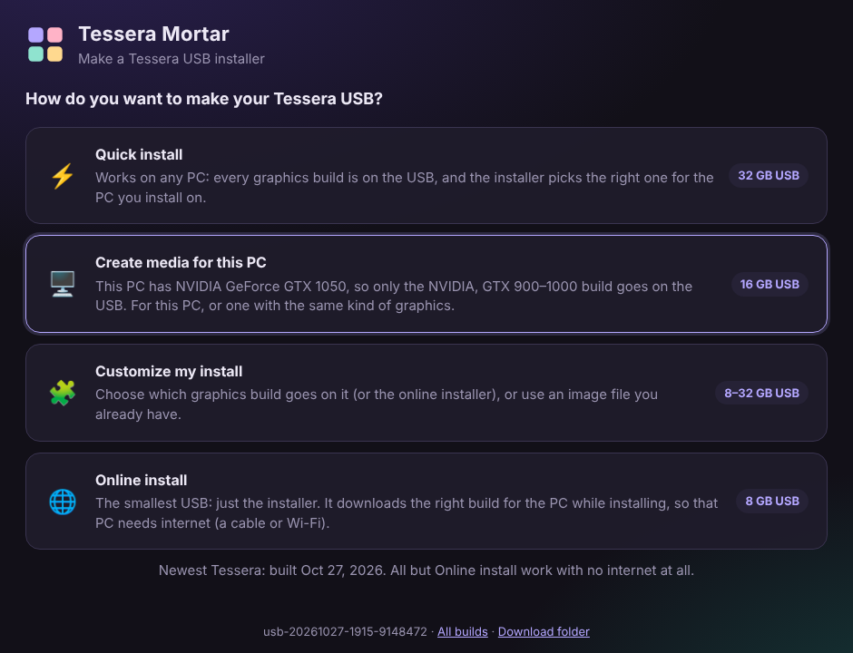 Four ways to make the USB. Mortar has spotted this PC's GTX 1050.</td>
<td width="50%">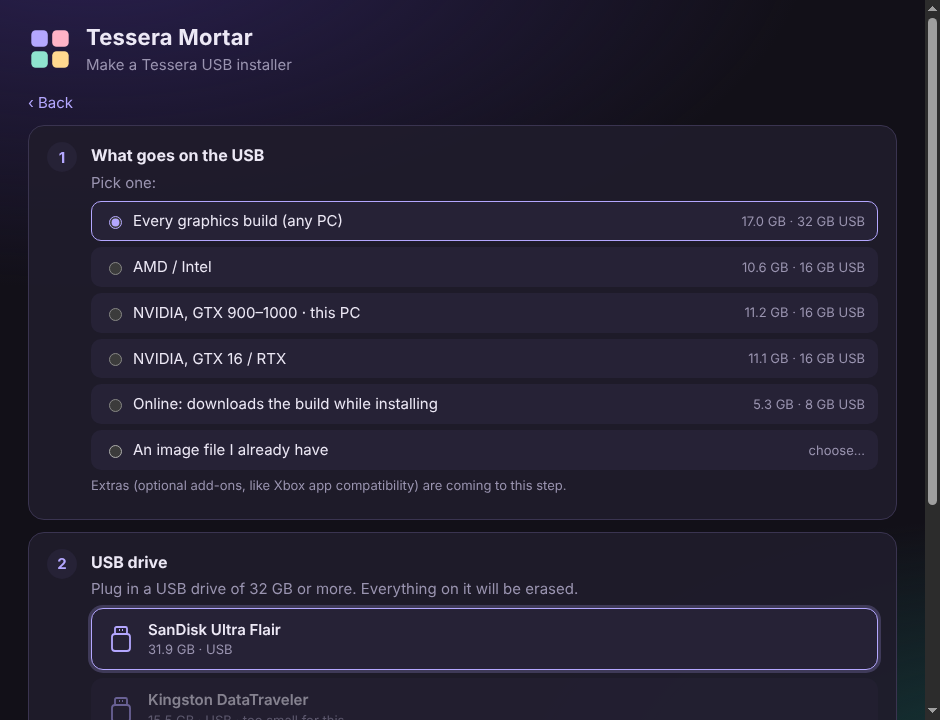 Customize: pick the build, with its download and USB size.</td>
</tr>
<tr>
<td>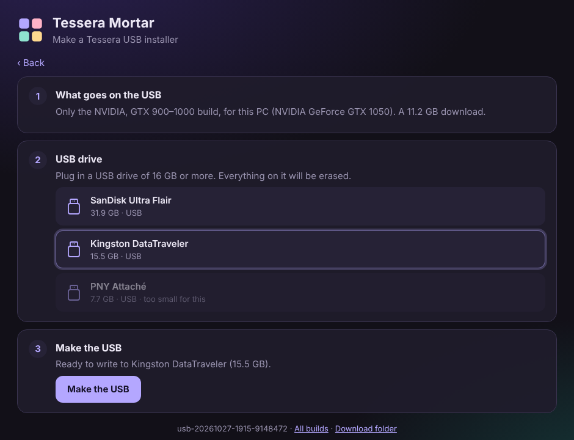 Pick the drive. Drives too small for your choice are greyed out.</td>
<td>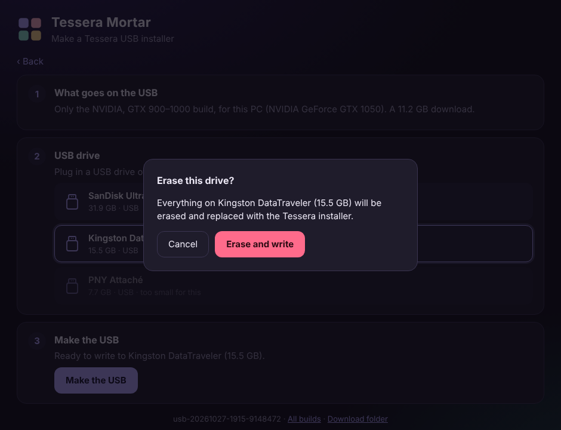 Mortar asks before it erases anything.</td>
</tr>
<tr>
<td>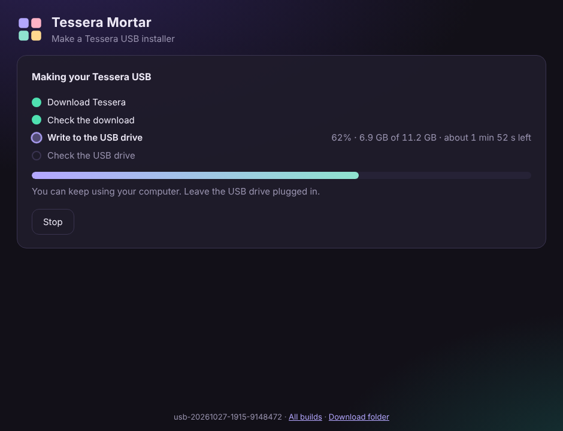 Download, check, write, then read the USB back.</td>
<td>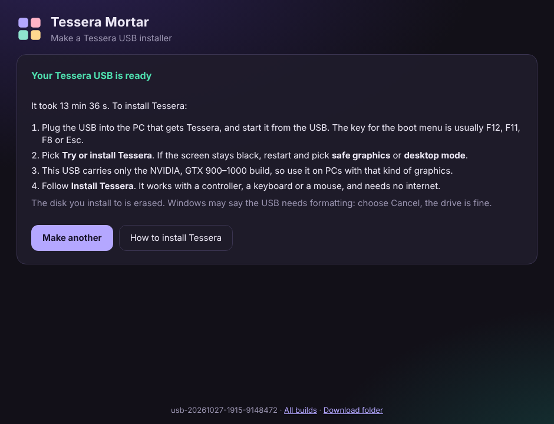 Done, with what to do next.</td>
</tr>
</table>

### On the PC you install to

The USB starts into **Install Tessera**, which works with a controller, a keyboard or a mouse.

<table>
<tr>
<td width="50%">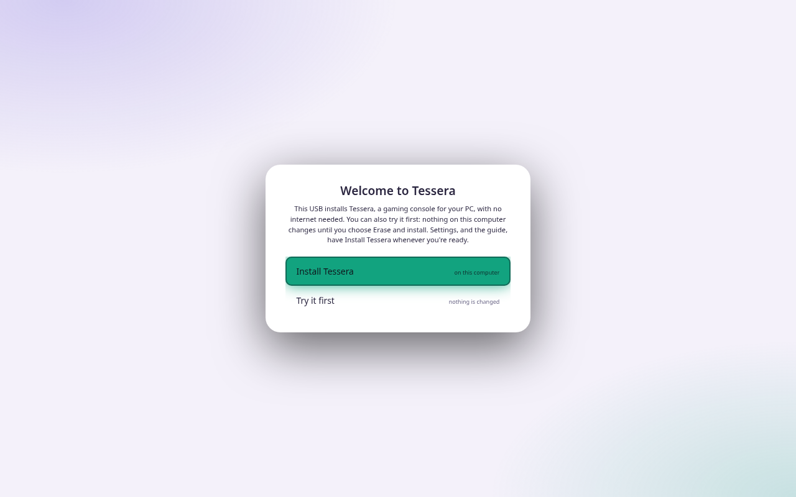 Install, or try it first. Nothing changes until you choose Erase and install.</td>
<td width="50%">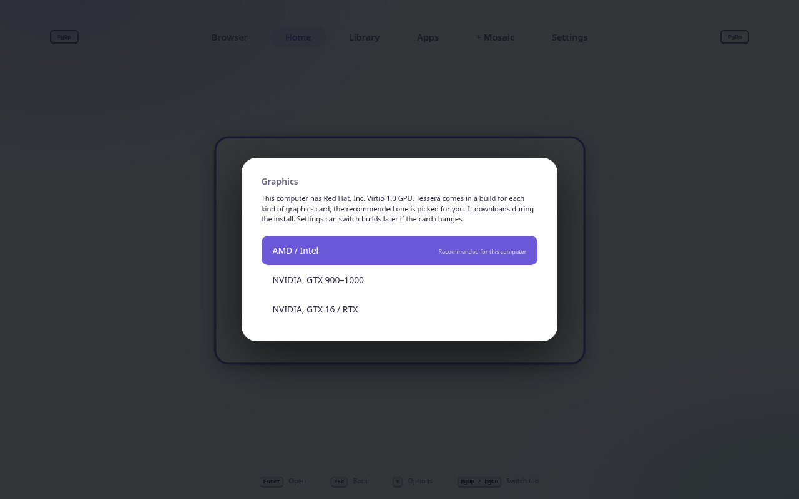 The build for this PC's graphics is picked for you.</td>
</tr>
<tr>
<td>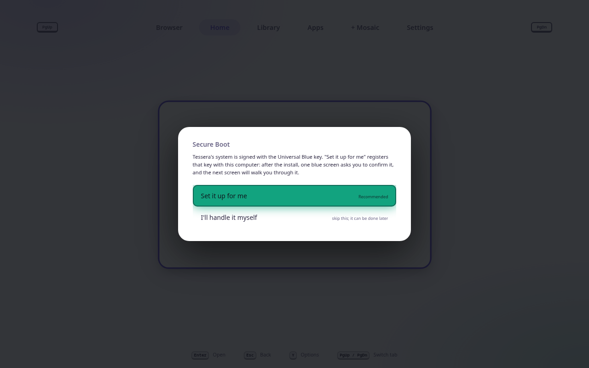 Secure Boot: set it up for me, or handle it yourself.</td>
<td>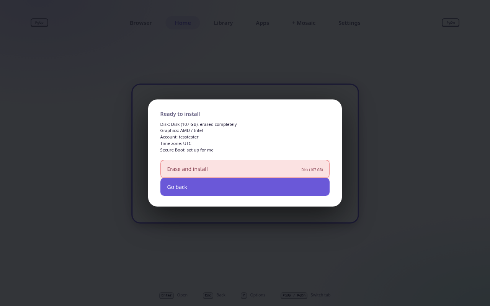 A summary before anything is erased.</td>
</tr>
<tr>
<td>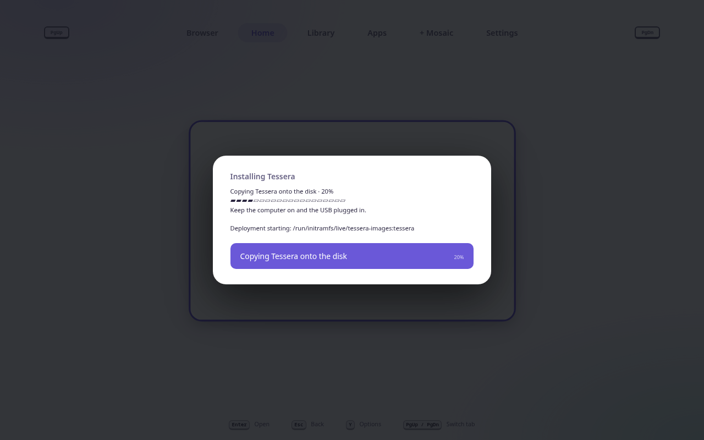 Installing: about 8 minutes in testing.</td>
<td>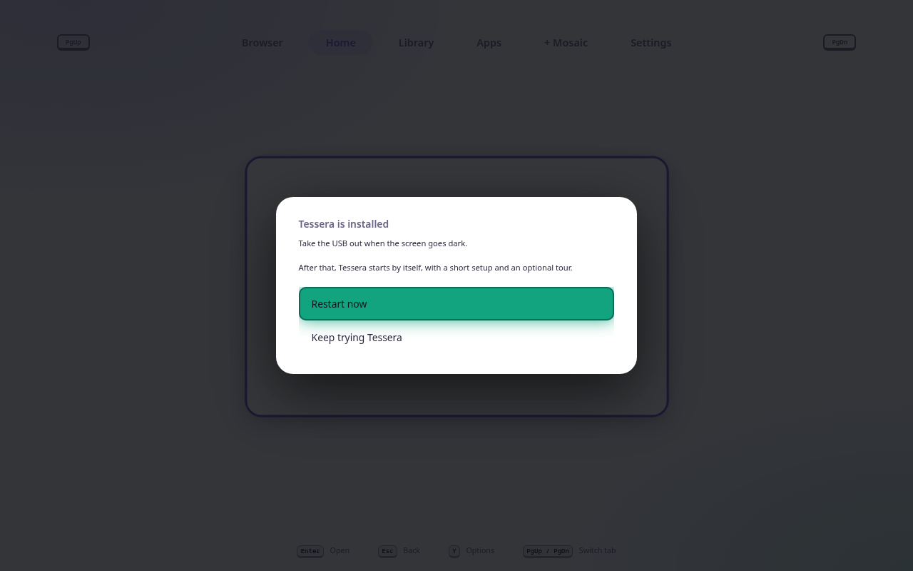 Installed. Take the USB out and restart.</td>
</tr>
</table>

Mortar screenshots use a stand-in drive list and GPU, so no real USB drive was written. Installer screenshots come from the automatic install test in a virtual machine, which runs Install Tessera in desktop mode (that is why it shows the VM's "Virtio" graphics).

## Try the test USB without Mortar

GitHub builds a test image of the USB after every change: see [Releases](https://github.com/Herbalchemist/tessera-mortar/releases). It's about 17 GB, so it comes in parts.

1. Download every `Tessera-Live.iso.partNN` file and `Tessera-Live.iso.sha256` from the newest release.
2. Join the parts into one file:
   - **Linux:** `cat Tessera-Live.iso.part* > Tessera-Live.iso`
   - **Windows (Command Prompt):** `copy /b Tessera-Live.iso.part00+Tessera-Live.iso.part01+… Tessera-Live.iso`, listing every part in order.
3. Check the file: `sha256sum -c Tessera-Live.iso.sha256` on Linux, or compare against `certutil -hashfile Tessera-Live.iso SHA256` on Windows.
4. Write it to a **32 GB or larger** USB drive with balenaEtcher, Fedora Media Writer, Rufus (in DD mode) or `dd`. Everything on the drive is erased.
5. Boot the target PC from the USB (UEFI). The boot menu has three entries:
   - **Try or install Tessera:** the normal one, starting into Install Tessera.
   - **Safe graphics:** for screens that stay black.
   - **Desktop mode:** the KDE desktop, with Install Tessera in a window.

**The install erases the disk you pick.** Use a spare disk or machine while this is in testing.

## Tools that work today

- `tools/measure-images.py`: how big an offline USB needs to be. It reads the published Tessera images' manifests and adds up their layers, counting layers the builds share only once. It also runs on GitHub (Actions › *Measure images*).

## License

GPL-3.0-or-later, like Tessera.
